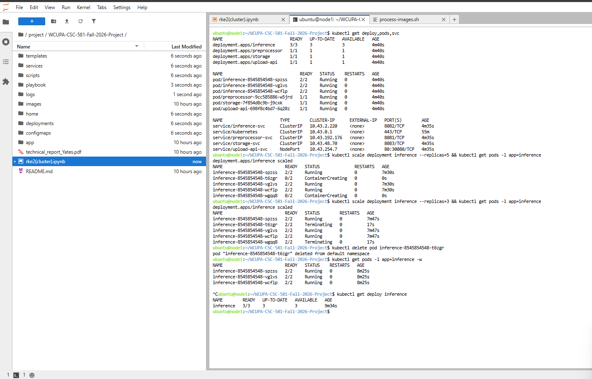
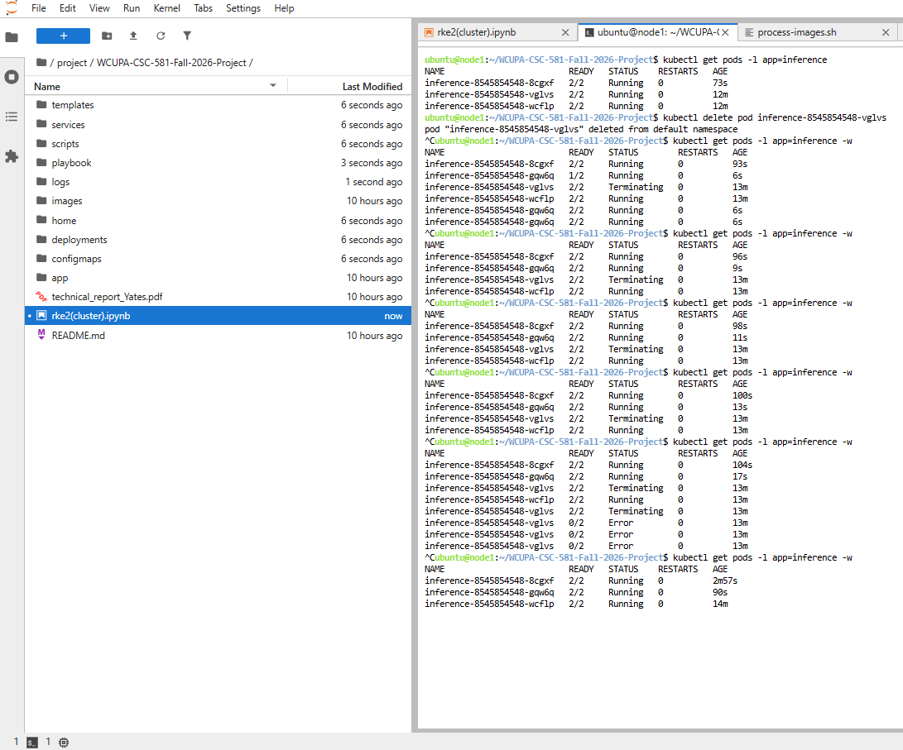

# CSC 581 Project – Core Implementation

This project introduces a Kubernetes object-detection pipeline running on an RKE2 cluster (FABRIC testbed, provisioned with `rke2(cluster).ipynb`).
 **There is no persistence yet**: storage uses `emptyDir`.

## Architecture


| Component | Kind | Replicas | Service | Port |
|---|---|---:|---|---:|
| upload-api | Deployment | 1 | `upload-api-svc` (NodePort 30080) | 8080 |
| preprocessor | Deployment | 1 | `preprocessor-svc` (ClusterIP) | 8081 |
| inference + access-logger sidecar | Deployment | 3 | `inference-svc` (ClusterIP) | 8082 |
| storage (emptyDir) | Deployment | 1 | `storage-svc` (ClusterIP) | 8083 |

Services find each other through Kubernetes DNS (for example `http://inference-svc:8082`). All inter-service calls use timeouts and retries.

## Files

```
Main Component Files:
app/          Python source for the 4 services (+ common.py as a helper)
configmaps/   pipeline-code-configmap.yaml
deployments/  upload-api-deployment.yaml, preprocessor-deployment.yaml, inference-deployment.yaml, storage-deployment.yaml
services/     upload-api-svc, preprocessor-svc, inference-svc, storage-svc .yaml
scripts/      test-pipeline.sh, make-configmap.sh, process-images.sh

FABRIC Files:
playbook/     Playbooks to run kubectl and other commands on every node
templates/    Templates for the .yml files
home/fabric   entrypoint.sh (.sh file to run the jupyter notebooker cluster for verification.)

Other Files:
architecture/ Image of the architecture it'self
images/       Folder to place images for processing through the pipeline
technical_report_Yates.pdf Technical report of the overall goal and background of the project.
```

## Steps to Deploy (Only in node1)

```bash
kubectl apply -f configmaps/
kubectl apply -f deployments/
kubectl apply -f services/
kubectl get deploy,pods,svc -o wide 
```

## Accessing the external Service

`upload-api-svc` is a NodePort service on port **30080** of every node.

```bash
# from node1
./scripts/test-pipeline.sh                                  # generates a tiny PNG and runs the full flow
./scripts/test-pipeline.sh mypicture.jpg                    # or use your own JPEG/PNG

# manual
curl -F image=@mypicture.jpg http://localhost:30080/images  # -> 202 {"id": "<uuid>"}
curl http://localhost:30080/images/<uuid>/result            # -> 202 while processing, 200 with JSON when done
```

## Evidence/proof:
```bash
kubectl get deploy,pods,svc
kubectl scale deployment inference --replicas=5 && kubectl get pods -l app=inference
kubectl scale deployment inference --replicas=3 && kubectl get pods -l app=inference
kubectl delete pod <one-inference-pod-name>
kubectl get pods -l app=inference -w
kubectl get deploy inference
```
### Evidence 1:


### Evidence 2 (Self Healing):


## Sidecar rationale
Each inference Pod runs an access-logger sidecar (busybox) next to the inference container. The two containers share an emptyDir volume: inference appends one line for every request. The sidecar streams that file to stdout so you can read it with `kubectl logs <pod> -c access-logger`. The request logging stays separate from the inference code. You can also replace or upgrade the logger such as a metrics exporter, without changing or restarting the model container. On which the logs show any of the three replicas served each request.

## Known limitations 

- Deleting the storage Pod erases all uploads and results, because `emptyDir` only lasts for a short time. With A PersistentVolumeClaim that can help with saving the data.
- Inference is a placeholder until MobileNet-SSD is integrated.
